## Myeongseok Kang

📍&nbsp;**Seoul,&nbsp;Korea** &nbsp;&nbsp; 🚀&nbsp;**ToolnjoyCompany&nbsp;Founder** 
🪪&nbsp;Engineer&nbsp;Information&nbsp;Processing, SQLD,&nbsp;PCCP

<a href="https://raw.githubusercontent.com/dooly6276/dooly6276/assets/assets/stack/stack-9eadad2.svg?v=ee361527"><picture>
  <source media="(max-width: 431px) and (prefers-color-scheme: dark)" srcset="https://raw.githubusercontent.com/dooly6276/dooly6276/assets/assets/stack/stack-narrow-dark-9eadad2.svg?v=6e19e34e" />
  <source media="(max-width: 431px)" srcset="https://raw.githubusercontent.com/dooly6276/dooly6276/assets/assets/stack/stack-narrow-9eadad2.svg?v=7caaf507" />
  <source media="(max-width: 1143px) and (prefers-color-scheme: dark)" srcset="https://raw.githubusercontent.com/dooly6276/dooly6276/assets/assets/stack/stack-mid-dark-9eadad2.svg?v=eed7872d" />
  <source media="(max-width: 1143px)" srcset="https://raw.githubusercontent.com/dooly6276/dooly6276/assets/assets/stack/stack-mid-9eadad2.svg?v=82e397a3" />
  <source media="(prefers-color-scheme: dark)" srcset="https://raw.githubusercontent.com/dooly6276/dooly6276/assets/assets/stack/stack-dark-9eadad2.svg?v=1241d9c4" />
  
</picture></a>

## Projects

<table>
  <tr>
    <td>
      <a href="https://toolnjoy.com"><picture><source media="(min-width: 1280px)" srcset="https://raw.githubusercontent.com/dooly6276/dooly6276/assets/assets/media/toolnjoy.gif?v=63708c2b" width="400" height="250" /><source media="(min-width: 1240px)" srcset="https://raw.githubusercontent.com/dooly6276/dooly6276/assets/assets/media/toolnjoy.gif?v=63708c2b" width="360" height="225" />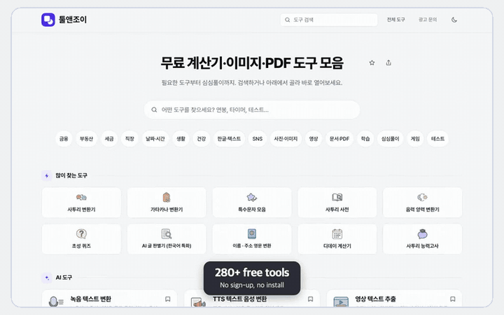</picture></a>
      
      <h3>&nbsp;<a href="https://toolnjoy.com"><picture><source media="(prefers-color-scheme: dark)" srcset="https://raw.githubusercontent.com/dooly6276/dooly6276/assets/assets/title/toolnjoy-dark.svg?v=b0d4081e" /></picture></a> </h3>
      <b>100K+ views, 1K+ daily users</b> 
      More than 280 free web services, from calculators, document and image conversion, photo upscaling, vocal removal and text-to-speech to browser games, quizzes and personality tests. Files are processed in the browser, not on a server.
       
    </td>
  </tr>
</table>

<table>
  <tr>
    <td>
      <a href="https://raw.githubusercontent.com/dooly6276/dooly6276/assets/assets/media/pasteplay.gif?v=b5ad782c"><picture><source media="(min-width: 1280px)" srcset="https://raw.githubusercontent.com/dooly6276/dooly6276/assets/assets/media/pasteplay.gif?v=b5ad782c" width="400" height="250" /><source media="(min-width: 1240px)" srcset="https://raw.githubusercontent.com/dooly6276/dooly6276/assets/assets/media/pasteplay.gif?v=b5ad782c" width="360" height="225" /></picture></a>
      
      <h3>&nbsp;<a href="https://raw.githubusercontent.com/dooly6276/dooly6276/assets/assets/media/pasteplay.gif?v=b5ad782c"><picture><source media="(prefers-color-scheme: dark)" srcset="https://raw.githubusercontent.com/dooly6276/dooly6276/assets/assets/title/pasteplay-dark.svg?v=c817bba7" /></picture></a> </h3>
      <b>Script-to-video service</b> 
      Turns a pasted script into a video for YouTube, Shorts or Instagram, with a range of visual styles and royalty-free background music. Videos are rendered in the browser as MP4 files.
       
    </td>
  </tr>
</table>

<table>
  <tr>
    <td>
      <a href="https://gichulkok.com"><picture><source media="(min-width: 1280px)" srcset="https://raw.githubusercontent.com/dooly6276/dooly6276/assets/assets/media/gichulkok.gif?v=fa2003dc" width="400" height="250" /><source media="(min-width: 1240px)" srcset="https://raw.githubusercontent.com/dooly6276/dooly6276/assets/assets/media/gichulkok.gif?v=fa2003dc" width="360" height="225" />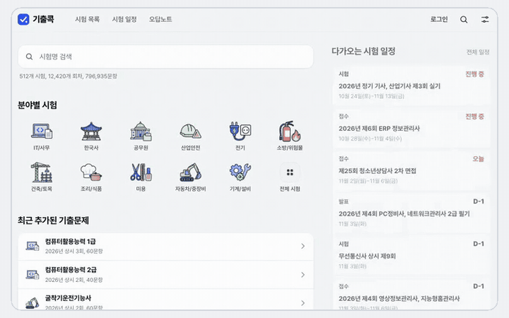</picture></a>
      
      <h3>&nbsp;<a href="https://gichulkok.com"><picture><source media="(prefers-color-scheme: dark)" srcset="https://raw.githubusercontent.com/dooly6276/dooly6276/assets/assets/title/gichulkok-dark.svg?v=208a3530" /></picture></a> </h3>
      <b>512 exams, 12,420 sessions, 797K questions</b> 
      Provides past questions from national certification and civil service exams by session, with a timed exam mode and automatic grading of multiple-choice questions. Explanations are available for 547K questions.
       
    </td>
  </tr>
</table>

<table>
  <tr>
    <td>
      <a href="https://joyoftools.com/en/"><picture><source media="(min-width: 1280px)" srcset="https://raw.githubusercontent.com/dooly6276/dooly6276/assets/assets/media/joyoftools.gif?v=00d44076" width="400" height="250" /><source media="(min-width: 1240px)" srcset="https://raw.githubusercontent.com/dooly6276/dooly6276/assets/assets/media/joyoftools.gif?v=00d44076" width="360" height="225" />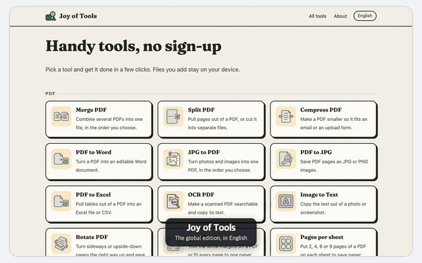</picture></a>
      
      <h3>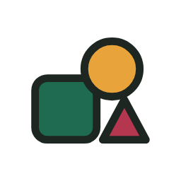&nbsp;<a href="https://joyoftools.com/en/"><picture><source media="(prefers-color-scheme: dark)" srcset="https://raw.githubusercontent.com/dooly6276/dooly6276/assets/assets/title/joyoftools-dark.svg?v=e058949b" /></picture></a> </h3>
      <b>The global edition of Toolnjoy</b> 
      The English edition of Toolnjoy for users outside Korea, with free PDF, image and text tools and take-home pay calculators for the US, UK, Canada, Germany and Japan. No sign-up is required, and files stay on the user's device.
       
    </td>
  </tr>
</table>

<table>
  <tr>
    <td>
      <a href="https://reportzone.kr"><picture><source media="(min-width: 1280px)" srcset="https://raw.githubusercontent.com/dooly6276/dooly6276/assets/assets/media/reportzone.png?v=3e4c7d44" width="400" height="250" /><source media="(min-width: 1240px)" srcset="https://raw.githubusercontent.com/dooly6276/dooly6276/assets/assets/media/reportzone.png?v=3e4c7d44" width="360" height="225" />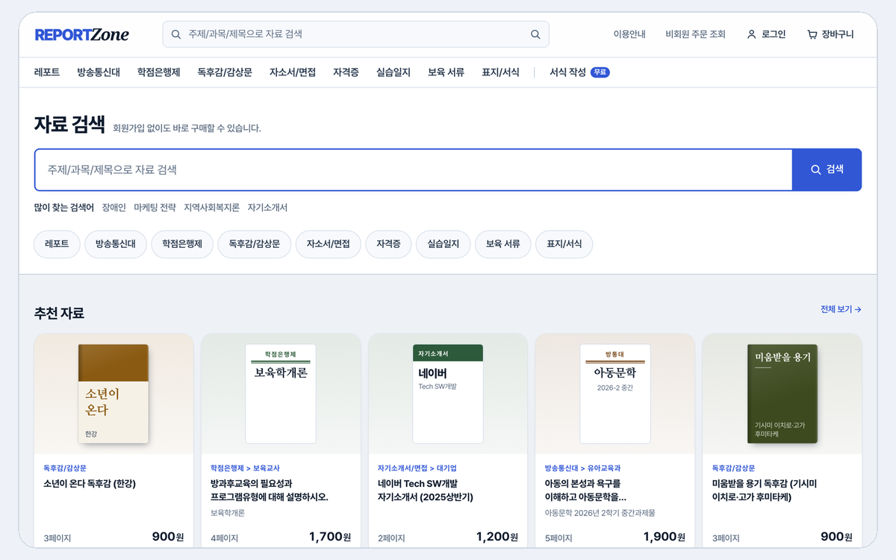</picture></a>
      
      <h3>&nbsp;<a href="https://reportzone.kr"><picture><source media="(prefers-color-scheme: dark)" srcset="https://raw.githubusercontent.com/dooly6276/dooly6276/assets/assets/title/reportzone-dark.svg?v=1d9c36da" /></picture></a> </h3>
      <b>50K+ documents</b> 
      A library of report samples, book reviews and cover letter examples produced by ReportZone. Every document is provided in HWP, Word and PDF formats.
       
    </td>
  </tr>
</table>

<table>
  <tr>
    <td>
      <a href="https://raw.githubusercontent.com/dooly6276/dooly6276/assets/assets/media/lucido.png?v=4ba3467e"><picture><source media="(min-width: 1280px)" srcset="https://raw.githubusercontent.com/dooly6276/dooly6276/assets/assets/media/lucido.png?v=4ba3467e" width="400" height="250" /><source media="(min-width: 1240px)" srcset="https://raw.githubusercontent.com/dooly6276/dooly6276/assets/assets/media/lucido.png?v=4ba3467e" width="360" height="225" />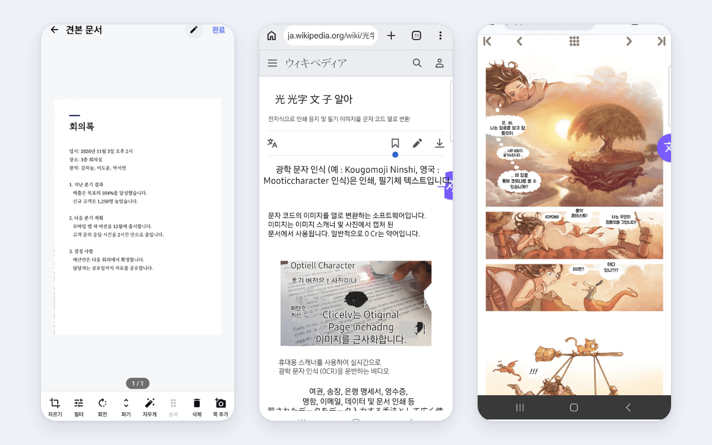</picture></a>
      
      <h3>&nbsp;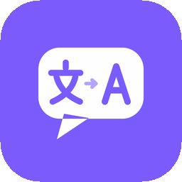&nbsp;<a href="https://raw.githubusercontent.com/dooly6276/dooly6276/assets/assets/media/lucido.png?v=4ba3467e"><picture><source media="(prefers-color-scheme: dark)" srcset="https://raw.githubusercontent.com/dooly6276/dooly6276/assets/assets/title/lucido-1-dark.svg?v=416e1db3" /></picture></a> <a href="https://raw.githubusercontent.com/dooly6276/dooly6276/assets/assets/media/lucido.png?v=4ba3467e"><picture><source media="(prefers-color-scheme: dark)" srcset="https://raw.githubusercontent.com/dooly6276/dooly6276/assets/assets/title/lucido-2-dark.svg?v=7b3ca817" /></picture></a>   </h3>
      <b>Document scanner and screen translator</b> 
      Lucido Scan saves documents and book pages as searchable PDF files. Lucido Lens translates on-screen text in other apps, such as comics, games and video subtitles. Neither app shows ads or requires an account.
       
    </td>
  </tr>
</table>

<table>
  <tr>
    <td>
      <a href="https://play.google.com/store/apps/details?id=app.paperon"><picture><source media="(min-width: 1280px)" srcset="https://raw.githubusercontent.com/dooly6276/dooly6276/assets/assets/media/thumb/paperon.png?v=fdd7c835" width="400" height="250" /><source media="(min-width: 1240px)" srcset="https://raw.githubusercontent.com/dooly6276/dooly6276/assets/assets/media/thumb/paperon.png?v=fdd7c835" width="360" height="225" />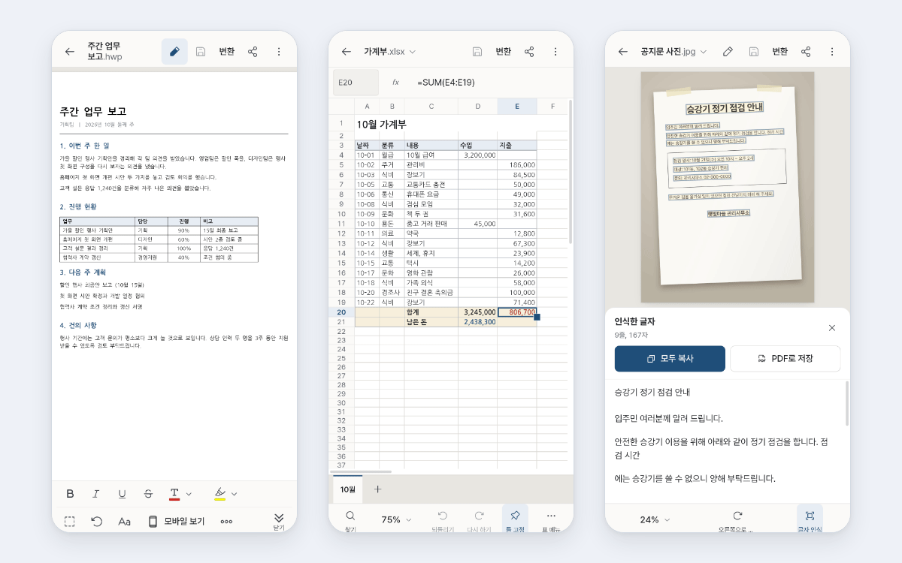</picture></a>
      
      <h3>&nbsp;<a href="https://play.google.com/store/apps/details?id=app.paperon"><picture><source media="(prefers-color-scheme: dark)" srcset="https://raw.githubusercontent.com/dooly6276/dooly6276/assets/assets/title/paperon-dark.svg?v=1910e5d2" /></picture></a>   </h3>
      <b>Document editor for HWP, PDF and Office files</b> 
      Opens, edits and saves HWP, Word, Excel, PowerPoint and PDF files, converts between formats, merges and signs PDFs, and recognizes text in scanned pages offline. Free, with no ads.
       
    </td>
  </tr>
</table>

<table>
  <tr>
    <td>
      <a href="https://play.google.com/store/apps/details?id=com.dooly.barrel"><picture><source media="(min-width: 1280px)" srcset="https://raw.githubusercontent.com/dooly6276/dooly6276/assets/assets/media/thumb/barrel.png?v=48f6f749" width="400" height="250" /><source media="(min-width: 1240px)" srcset="https://raw.githubusercontent.com/dooly6276/dooly6276/assets/assets/media/thumb/barrel.png?v=48f6f749" width="360" height="225" />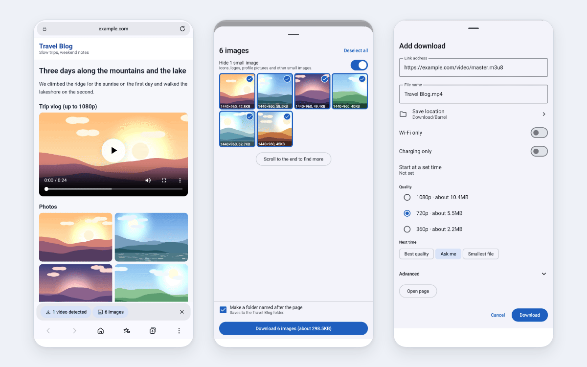</picture></a>
      
      <h3>&nbsp;<a href="https://play.google.com/store/apps/details?id=com.dooly.barrel"><picture><source media="(prefers-color-scheme: dark)" srcset="https://raw.githubusercontent.com/dooly6276/dooly6276/assets/assets/title/barrel-dark.svg?v=6f503e56" /></picture></a> </h3>
      <b>Ad-blocking browser and download manager</b> 
      Blocks ads and trackers, and downloads videos, streams and images from the page being viewed. Large files download over multiple connections, and Smart Connection gets around network blocks. Available in 26 languages.
       
    </td>
  </tr>
</table>

<table>
  <tr>
    <td>
      <a href="https://raw.githubusercontent.com/dooly6276/dooly6276/assets/assets/media/thumb/keepro.png?v=2322ba20"><picture><source media="(min-width: 1280px)" srcset="https://raw.githubusercontent.com/dooly6276/dooly6276/assets/assets/media/thumb/keepro.png?v=2322ba20" width="400" height="250" /><source media="(min-width: 1240px)" srcset="https://raw.githubusercontent.com/dooly6276/dooly6276/assets/assets/media/thumb/keepro.png?v=2322ba20" width="360" height="225" />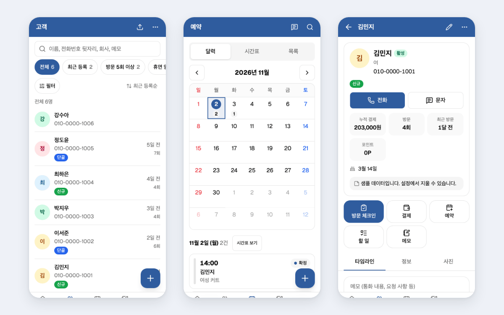</picture></a>
      
      <h3>&nbsp;<a href="https://raw.githubusercontent.com/dooly6276/dooly6276/assets/assets/media/thumb/keepro.png?v=2322ba20"><picture><source media="(prefers-color-scheme: dark)" srcset="https://raw.githubusercontent.com/dooly6276/dooly6276/assets/assets/title/keepro-dark.svg?v=9a775875" /></picture></a>  </h3>
      <b>Customer management app for small businesses</b> 
      Manages customers, bookings, sales, memberships and points, and shows the registered customer's details on incoming calls. Data is stored only on the device, and no account is required.
       
    </td>
  </tr>
</table>

<table>
  <tr>
    <td>
      <a href="https://raw.githubusercontent.com/dooly6276/dooly6276/assets/assets/media/thumb/talkhelper.png?v=74a0ae47"><picture><source media="(min-width: 1280px)" srcset="https://raw.githubusercontent.com/dooly6276/dooly6276/assets/assets/media/thumb/talkhelper.png?v=74a0ae47" width="400" height="250" /><source media="(min-width: 1240px)" srcset="https://raw.githubusercontent.com/dooly6276/dooly6276/assets/assets/media/thumb/talkhelper.png?v=74a0ae47" width="360" height="225" />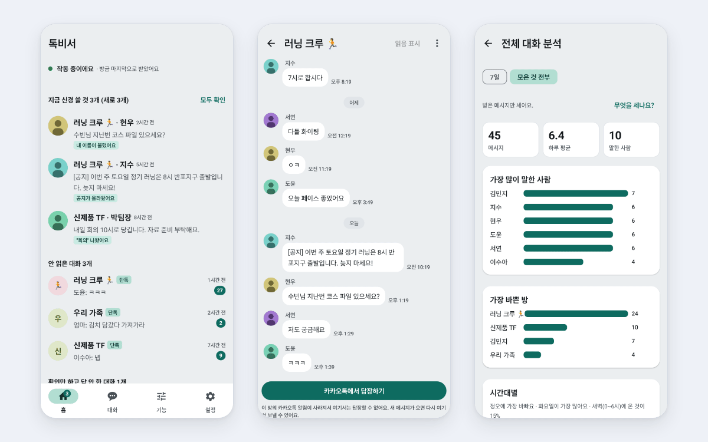</picture></a>
      
      <h3>&nbsp;<a href="https://raw.githubusercontent.com/dooly6276/dooly6276/assets/assets/media/thumb/talkhelper.png?v=74a0ae47"><picture><source media="(prefers-color-scheme: dark)" srcset="https://raw.githubusercontent.com/dooly6276/dooly6276/assets/assets/title/talkhelper-dark.svg?v=377250c4" /></picture></a> </h3>
      <b>KakaoTalk notification assistant</b> 
      Alerts the user when their name, a chosen keyword or a notice appears in a chat, replies automatically while driving or in meetings, and keeps messages deleted by the sender while the notification remains. Uses no internet permission.
       
    </td>
  </tr>
</table>

<table>
  <tr>
    <td>
      <a href="https://raw.githubusercontent.com/dooly6276/dooly6276/assets/assets/media/thumb/zenet.png?v=59b1a941"><picture><source media="(min-width: 1280px)" srcset="https://raw.githubusercontent.com/dooly6276/dooly6276/assets/assets/media/thumb/zenet.png?v=59b1a941" width="400" height="250" /><source media="(min-width: 1240px)" srcset="https://raw.githubusercontent.com/dooly6276/dooly6276/assets/assets/media/thumb/zenet.png?v=59b1a941" width="360" height="225" />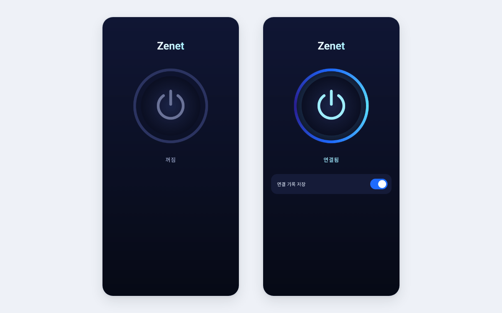</picture></a>
      
      <h3>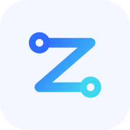&nbsp;<a href="https://raw.githubusercontent.com/dooly6276/dooly6276/assets/assets/media/thumb/zenet.png?v=59b1a941"><picture><source media="(prefers-color-scheme: dark)" srcset="https://raw.githubusercontent.com/dooly6276/dooly6276/assets/assets/title/zenet-dark.svg?v=5678e3ef" /></picture></a> </h3>
      <b>On-device security VPN</b> 
      Applies to all apps on the device without routing traffic through an external server, and adjusts how connections start on networks where they do not go through smoothly. No account is required.
       
    </td>
  </tr>
</table>

<table>
  <tr>
    <td>
      <a href="https://raw.githubusercontent.com/dooly6276/dooly6276/assets/assets/media/thumb/sketchbon.gif?v=35b2b588"><picture><source media="(min-width: 1280px)" srcset="https://raw.githubusercontent.com/dooly6276/dooly6276/assets/assets/media/thumb/sketchbon.gif?v=35b2b588" width="400" height="250" /><source media="(min-width: 1240px)" srcset="https://raw.githubusercontent.com/dooly6276/dooly6276/assets/assets/media/thumb/sketchbon.gif?v=35b2b588" width="360" height="225" />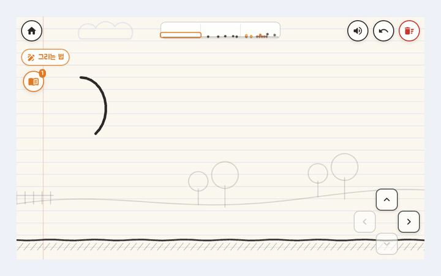</picture></a>
      
      <h3>&nbsp;<a href="https://raw.githubusercontent.com/dooly6276/dooly6276/assets/assets/media/thumb/sketchbon.gif?v=35b2b588"><picture><source media="(prefers-color-scheme: dark)" srcset="https://raw.githubusercontent.com/dooly6276/dooly6276/assets/assets/title/sketchbon-dark.svg?v=c4dc1c11" /></picture></a>  </h3>
      <b>Drawing-based physics puzzle game</b> 
      Recognizes the player's drawings on the device and turns them into objects that move according to physics. Includes 65 stages across 7 chapters, a sandbox mode and four mini games.
       
    </td>
  </tr>
</table>

 

<a href="https://raw.githubusercontent.com/dooly6276/dooly6276/output/activity.svg"><picture>
  <source media="(max-width: 1023px) and (prefers-color-scheme: dark)" srcset="https://raw.githubusercontent.com/dooly6276/dooly6276/output/activity-narrow-dark.svg" />
  <source media="(max-width: 1023px)" srcset="https://raw.githubusercontent.com/dooly6276/dooly6276/output/activity-narrow.svg" />
  <source media="(prefers-color-scheme: dark)" srcset="https://raw.githubusercontent.com/dooly6276/dooly6276/output/activity-dark.svg" />
  
</picture></a>

