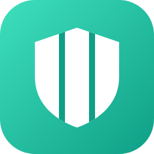

<table>
  <tr>
    <td width="33%" valign="top">
       
      &nbsp;<b>Toolnjoy</b>&nbsp;&nbsp; 
      <b>100K+ views, 1K+ daily users.</b> 280+ free tools for files, photos and audio.
    </td>
    <td width="33%" valign="top">
       
      &nbsp;<b>PastePlay</b>&nbsp;&nbsp; 
      <b>Script to video.</b> Paste a script, get a video for YouTube or Instagram.
    </td>
    <td width="33%" valign="top">
       
      &nbsp;<b>ReportZone</b>&nbsp;&nbsp; 
      <b>50K+ documents.</b> Report samples and book reviews in HWP, Word and PDF.
    </td>
  </tr>
  <tr>
    <td width="33%" valign="top">
       
      &nbsp;<b>claude-bulkhead</b>&nbsp;&nbsp;&nbsp;&nbsp; 
      <b>Claude Code guardrails.</b> Run many sessions on one machine, safely.
    </td>
    <td width="33%" valign="top">
       
      &nbsp;&nbsp;<b>Lucido Scan & Lens</b>&nbsp;&nbsp;&nbsp;&nbsp; 
      <b>Translate any app, right on screen.</b> And scan paper into searchable PDFs.
    </td>
    <td width="33%" valign="top">
       
      &nbsp;<b>Gichulkok (CBT)</b>&nbsp;&nbsp; 
      <b>800K+ questions, 540K+ explained.</b> Timed practice across 500+ exams.
    </td>
  </tr>
  <tr>
    <td width="33%" valign="top">
       
      &nbsp;<b>Paperon Office</b>&nbsp;&nbsp;&nbsp;&nbsp; 
      <b>HWP, PDF and Office editor.</b> Edit and convert any document on your phone.
    </td>
    <td width="33%" valign="top">
       
      &nbsp;<b>Barrel</b>&nbsp;&nbsp; 
      <b>Ad-blocking browser.</b> Download videos, streams and images.
    </td>
    <td width="33%" valign="top">
       
      &nbsp;<b>Keepro CRM</b>&nbsp;&nbsp;&nbsp; 
      <b>CRM for small businesses.</b> Track customers, bookings and sales.
    </td>
  </tr>
  <tr>
    <td width="33%" valign="top">
       
      &nbsp;<b>Sketchborn</b>&nbsp;&nbsp;&nbsp; 
      <b>Your drawings come to life.</b> Draw a ball and it rolls, a balloon and it floats.
    </td>
    <td width="33%" valign="top">
       
      &nbsp;<b>Zenet</b>&nbsp;&nbsp; 
      <b>Fast VPN, no middleman.</b> Protects every app without slowing it down.
    </td>
    <td width="33%" valign="top">
       
      &nbsp;<b>Talkretary</b>&nbsp;&nbsp; 
      <b>KakaoTalk assistant.</b> Never miss a mention, and auto-reply when busy.
    </td>
  </tr>
</table>
